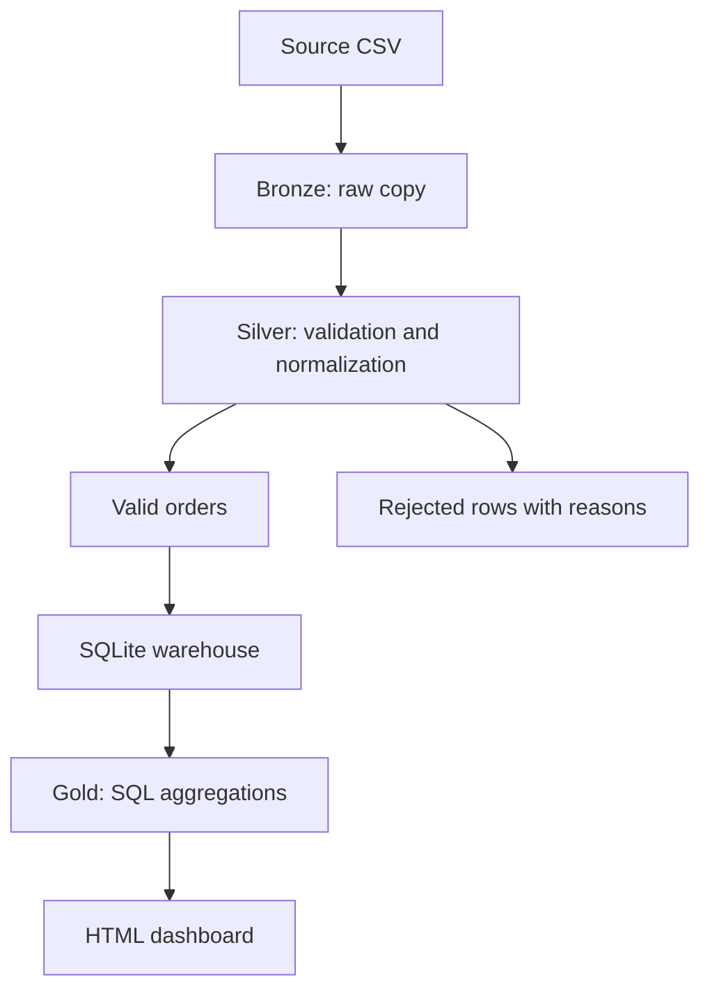

# Sales Lakehouse — Data Engineering Capstone

A runnable local implementation of the Bronze → Silver → Gold architecture using Python, CSV and SQLite. It ingests synthetic retail orders, checks data quality, creates business summaries and generates an offline HTML dashboard.

**Implementation status:** This repository runs locally. AWS S3, Glue, Athena and BigQuery are not deployed or used. The cloud mapping below is a proposed extension, not evidence of a cloud deployment. Check your course rubric before submitting: a local project may not meet a requirement for actual cloud services.

## Run in two steps

Install Python 3.10 or newer if needed. No additional packages, accounts, API keys or paid services are required.

1. Open a terminal in this project folder and run:

   ```sh
   python pipeline.py
   ```

   On Windows, use `py pipeline.py` if `python` is not recognized. On Linux/macOS, use `python3 pipeline.py`.

2. Open `output/dashboard.html` in your browser by double-clicking it.

Generated sample outputs are already included so you can inspect the project before running it. Run the command yourself to reproduce them.

## Architecture



The Bronze file is copied without modification. Each execution replaces the output snapshot; this is a full refresh, not an append-only ingestion history. The source CSV is retained. Silver transformations trim whitespace, normalize region/product capitalization, validate dates and positive quantities/prices, and keep the first valid occurrence of each order ID. Invalid rows and duplicates go into a separate CSV with their original values and rejection reasons. Gold produces daily, regional and product sales summaries using SQL.

Money is parsed with Python `Decimal` and stored as integer paise in SQLite. `revenue_cents` means hundredths of INR: divide by 100 for rupees. For example, 150000 represents ₹1,500.00.

## Dataset and verified results

`data/orders.csv` is synthetic demonstration data, not real customer data. It intentionally contains a duplicate, a negative quantity, a nonnumeric price, a missing customer ID and an invalid date.

| Metric | Expected result |
| --- | ---: |
| Input rows | 20 |
| Accepted orders | 15 |
| Rejected rows | 5 |
| Total revenue | ₹87,000.00 |

| Region | Revenue |
| --- | ---: |
| North | ₹30,500.00 |
| West | ₹21,500.00 |
| South | ₹18,000.00 |
| East | ₹17,000.00 |

## Files

| Path | Purpose |
| --- | --- |
| `pipeline.py` | Ingestion, cleaning, warehouse loading, aggregation and dashboard generation |
| `data/orders.csv` | Synthetic source dataset |
| `output/bronze/orders.csv` | Exact copy of source |
| `output/silver/orders_clean.csv` | Accepted and normalized records |
| `output/silver/rejected_rows.csv` | Rejected records and reasons |
| `output/gold/` | Daily, regional and product summaries |
| `output/warehouse.db` | Queryable SQLite warehouse |
| `output/quality_report.json` | Row counts, revenue and source SHA-256 checksum |
| `output/dashboard.html` | Offline dashboard; no server required |
| `sql/analytics.sql` | Example warehouse queries |
| `test_pipeline.py` | Integration and validation tests |
| `GITHUB_UPLOAD.md` | Upload instructions |
| `EXPLAIN_PROJECT.md` | Beginner-friendly explanation |

## Verify

```sh
python -m unittest -v
```

Tests check sample totals, rejection counts, Bronze/source byte equality, reconciliation of regional revenue, repeatable full refresh, invalid prices, duplicate policy and empty input.

To process another file with the same exact header:

```sh
python pipeline.py --input data/orders.csv --output output
```

## Proposed cloud extension

| Local component | Possible cloud equivalent |
| --- | --- |
| Bronze/Silver/Gold directories | Separate object-store prefixes in Amazon S3 |
| Python cleaning | AWS Glue ETL job, rewritten for Spark at larger scale |
| SQLite SQL aggregations | Athena queries over cataloged data |
| Local invocation | Scheduled workflow with monitoring |
| Local dashboard | Hosted dashboard or BI tool |

This mapping describes future work. No cloud configuration files or deployment evidence are included. A cloud version would need authentication, IAM permissions, encryption configuration, a catalog, monitoring and real execution verification.

## Limitations

- Small in-memory batch processing; not suitable for large datasets or streaming.
- CSV output rather than Parquet or a transactional lakehouse table format.
- SQLite is a local analytical demonstration, not a distributed warehouse.
- No orchestration service, incremental loads or slowly changing dimensions.
- An order ID represents one order row; multi-item order schemas require a different key.
- Region/product names are normalized but not checked against a master catalog.
- Output snapshots are overwritten; back up custom results before another run.
- No cloud deployment or cloud performance claims.

## Development disclosure

This project was generated with AI assistance as an educational starter. Review the code, reproduce the outputs and describe your own changes accurately. Follow your course's rules on assisted work.
